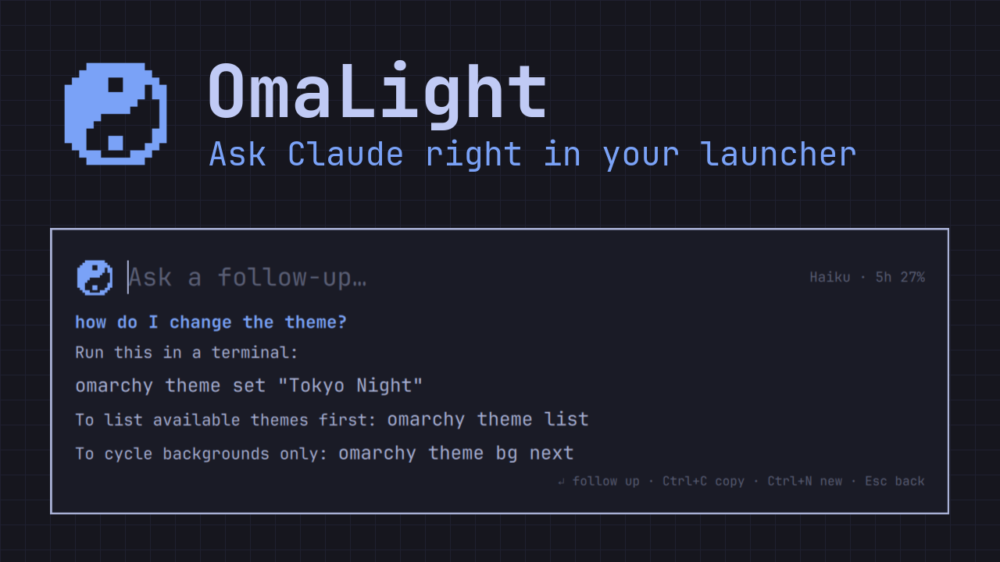

<p align="center"></p>

<h1 align="center">OmaLight</h1>

<p align="center">A Spotlight-style bar for <a href="https://omarchy.org">Omarchy</a>: find apps and files, or ask Claude and read the answer streamed right in the bar.</p>



- **One input for everything.** Apps, open windows, every action in the Omarchy menu, your keybindings, files and folders in your home, sums, and an "Ask Claude" row on top. Results of every kind are ranked together by how well they match.
- **Speaks Omarchy.** Apps Omarchy hides stay hidden, actions show where they live (*Omarchy › Style › Theme*), keybindings run through Omarchy's own dispatcher, and launching an app shows the same "Launching…" notice as the Omarchy menu. Apps you launch often rise to the top.
- **It tells a search from a question.** Text ending in `?`, four or more words, or starting with a question word (*how*, *what*, *why*, *как*, *что*…) lands on "Ask Claude". Anything else lands on the first app or file.
- **Answers stream in place**, rendered as Markdown. Press ↵ again to ask a follow-up in the same conversation.
- **Uses your Claude subscription** through the official [Claude Code](https://claude.com/claude-code) CLI. No API key. The default model is the newest **Haiku**, which is fast and light on your limits; <kbd>Ctrl</kbd>+<kbd>M</kbd> switches to Sonnet or Opus. Claude gets Omarchy's own agent guide, so answers about your system name the right files and keys.
- **On the bar.** A pixel yin-yang next to your workspaces opens the bar; its tooltip shows Claude's session and weekly limits, which the bar also shows next to the model name.
- **Looks like Omarchy.** It runs inside `omarchy-shell` and follows the active theme. The interface is in English, or Russian on a Russian locale.

## Requirements

- Omarchy with the Quickshell-based `omarchy-shell` (Omarchy Quattro).
- [Claude Code](https://claude.com/claude-code) installed and signed in: run `claude` once in a terminal and log in.
- `plocate` and `fd` for file search; Omarchy ships both. The plocate index refreshes daily, and `fd` covers whatever changed since, so new files are found right away.

## Install

```bash
omarchy plugin add https://github.com/Kostya9406/omalight.git --enable
```

Enabling adds the mark to the left of the bar; move it with `omarchy bar move io.github.kostya9406.omalight --section right`, or turn on *Show Claude's session limit* in the widget's settings.

OmaLight never changes your config, so bind a key yourself. Add this to `~/.config/hypr/bindings.lua`:

```lua
o.bind("ALT + SPACE", "OmaLight", "omarchy-shell shell toggle io.github.kostya9406.omalight")
```

Any free key works. Omarchy already uses <kbd>Super</kbd>+<kbd>Space</kbd> for its menu.

To open it from the Omarchy menu too, add a row to `~/.config/omarchy/extensions/omarchy-menu.jsonc`:

```jsonc
"omalight": {"icon":"\uf002","label":"OmaLight","description":"Find apps, files, actions, or ask Claude","action":"omarchy-shell shell toggle io.github.kostya9406.omalight"},
```

### Options

Pass a JSON payload in the binding. Both are remembered, so the bar widget and the menu row open with the same choice:

| Key | Values | Default |
|---|---|---|
| `model` | any `claude --model` value: `haiku`, `sonnet`, `opus`, or a full model id | `haiku` |
| `lang` | `en`, `ru` | system locale |

```lua
o.bind("ALT + SPACE", "OmaLight", "omarchy-shell shell toggle io.github.kostya9406.omalight '{\"model\":\"sonnet\",\"lang\":\"en\"}'")
```

## Keys

| Key | Action |
|---|---|
| <kbd>↵</kbd> | open, switch to, run or copy the selected result, or ask Claude on the first row |
| <kbd>Ctrl</kbd>+<kbd>↵</kbd> | always ask Claude |
| <kbd>Alt</kbd>+<kbd>↵</kbd> | open the file's folder |
| <kbd>↑</kbd> <kbd>↓</kbd> · <kbd>Tab</kbd> · <kbd>Ctrl</kbd>+<kbd>J</kbd>/<kbd>K</kbd> | pick a result |
| <kbd>↵</kbd> after an answer | ask a follow-up |
| <kbd>Ctrl</kbd>+<kbd>C</kbd> · <kbd>Super</kbd>+<kbd>C</kbd> | copy the last answer (Omarchy's universal copy works too, over terminals as well) |
| <kbd>Ctrl</kbd>+<kbd>V</kbd> · <kbd>Super</kbd>+<kbd>V</kbd> | paste into the bar |
| <kbd>Ctrl</kbd>+<kbd>N</kbd> | start a new conversation |
| <kbd>Ctrl</kbd>+<kbd>M</kbd> | switch the model: Haiku → Sonnet → Opus (or click its name) |
| <kbd>PgUp</kbd> <kbd>PgDn</kbd> | scroll the answer |
| <kbd>Esc</kbd> | stop the answer → back to search → clear → close |

## Privacy and safety

- Search stays local. Only text you send to Claude leaves the machine, to Anthropic through your own `claude` CLI, along with Omarchy's public agent guide from `$OMARCHY_PATH/default/agents/skills/omarchy`.
- Claude runs as `claude --safe-mode -p`, which loads none of your CLAUDE.md files, hooks, plugins or MCP servers. The only tools allowed are **WebSearch** and **WebFetch**: it cannot read your files or run commands.
- Everything OmaLight keeps is in `~/.local/state/omalight`: Claude's sessions (so follow-ups can `--resume` them), `settings.json` (model and language), `usage.json` (how often you launch what) and `picker/`, a two-line stand-in for `omarchy-menu-select` that lets a keybinding row run through `omarchy-menu-keybindings`.
- Omarchy menu actions run exactly as the Omarchy menu runs them: they are commands from Omarchy and from your own menu extension.
- Answers are untrusted text. Images and raw HTML are stripped before rendering, so nothing is fetched without a click, and only `http(s)` links open.
- Typed text and file paths reach programs only as separate arguments, never through a shell.

## Uninstall

```bash
omarchy plugin remove io.github.kostya9406.omalight
rm -rf ~/.local/state/omalight
```

Remove the `OmaLight` line from `~/.config/hypr/bindings.lua`.

## Development

- `files.sh`: the file search (plocate, plus fd since the last index refresh); try it with `bash files.sh <name>`.
- `OmaLight.qml`: the overlay. `BarWidget.qml`: the bar mark. `Search.js`: matching, ranking, the calculator, the Omarchy menu and keybinding readers, and stream parsing. `Strings.js`: interface text. `Icon.js` and `YinYang.qml`: the mark.
- `node tests/search.test.js` runs the logic tests.
- `node tools/make-icon.js [color] > icon.svg` redraws the icon from the same grid the overlay paints.
- `omarchy-shell` caches compiled QML, so run `omarchy restart shell` after editing.

## Credits

Modelled on [Lumi](https://github.com/AlbertS15/Lumi) by AlbertS15 (MIT). The question-word list and the search-or-question heuristic are adapted from it.

## License

[MIT](LICENSE)
